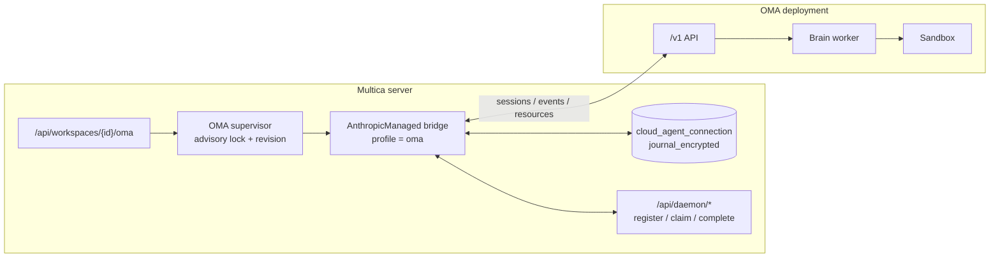
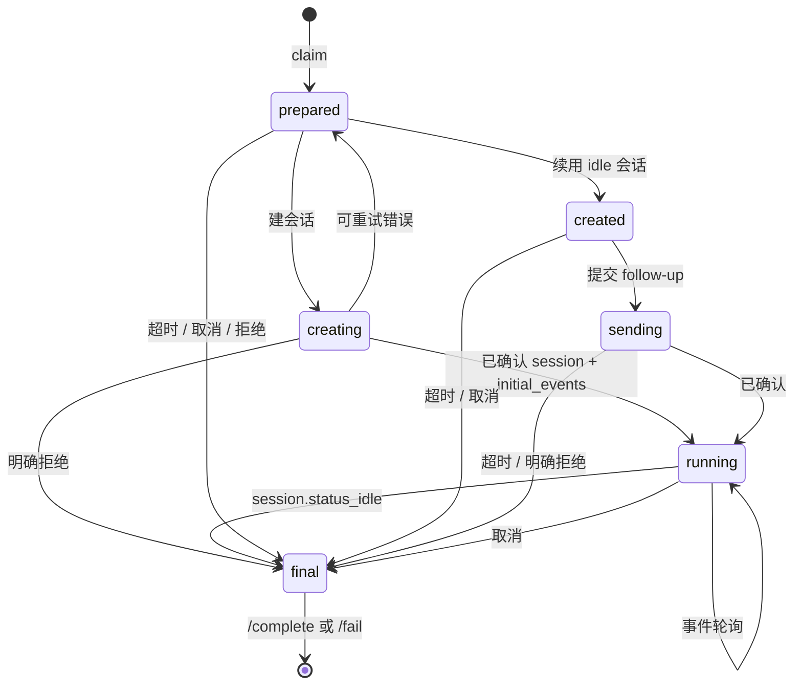

# OMA Cloud Runtime 接入规划

- 状态：Phase 1、Phase 2 已实现（2026-11-23）；Phase 3 服务端集成点已随 Phase 2 完成；Phase 4 前端代码已实现，但 `apps/docs` 与 OMA 专属品牌图标未完成；Phase 5/6 待联调与文档收尾
- 代码基线：`own-multica` / `langcli-and-oma`
- 记录日期：2026-11-23
- 关联：PR #9761（`claude_managed`，已在 `df7ad6443` 合并进本分支）
- 参考：`docs/research1.txt`（PR #9761 代码通读记录；本文已吸收其结论并采用 profile 化方案）

本文记录在 `own-multica` 上新增 `oma_cloud` 云运行时的设计与实施计划。OMA（Open Managed Agents）是 Anthropic Managed Agents 协议的自托管实现，现有 `claudemanagedruntime` 桥接代码可作为主要基础。

## 1. 背景与现状

`own-multica` 当前已经包含：

| 能力 | 代码位置 | 说明 |
| --- | --- | --- |
| Qoder Cloud Agents | `server/internal/qoderruntime`、`server/internal/handler/qoder_*` | provider `qoder_cloud` |
| Claude Managed Agents | `server/internal/claudemanagedruntime`、`server/internal/handler/claude_*`、`server/cmd/claude-managed-runtime` | provider `claude_managed`，来自 PR #9761 |
| langcli | `server/pkg/agent/builtin_runtimes.go` | 本地内置 runtime（protocol family `claude`），不是 cloud provider |
| 通用云连接表 | `server/migrations/586_cloud_agent_connection.up.sql` 与 `587` | `provider` 为自由文本；新增 provider 无需迁移 |

两套云连接 supervisor 已存在：

- `RunQoderConnections`：`server/cmd/server/main.go`
- `RunClaudeConnections`：`server/cmd/server/main.go`

现状结论：

- OMA 是第三个 cloud provider，不需要新增数据库迁移。
- 协议层不需要修改 OMA 代码；主要工作在多处 Multica 侧适配。
- 最大工程风险是复制出第三套 connection/supervisor/disconnect，而不是协议本身。

## 2. 目标与非目标

### 2.1 v1 目标

- issue 级云运行时，行为与 `claude_managed` 对齐：
  - 建会话、提交 prompt、轮询事件、回传消息、输出最终结果
  - 取消远端执行
  - 同一 issue 的 follow-up 续用
  - GitHub 仓库挂载与分支 checkout
  - vault 绑定
  - 并发上限、运行超时
  - 连接保存、检查、暂停、恢复、断开、工作区删除清理
- 支持自托管 OMA 的 base URL（http/https）。
- 上报 token 与成本用量。

### 2.2 v1 非目标

- quick-create
- squad / leader
- 多仓库、非 github.com 主机
- commit / tag checkout（仅 branch）
- 工具审批（桥不回答确认请求）
- session budget
- SSE 实时流（沿用轮询 + journal 恢复）

chat（文本、附件、回传文件）已实现，见本文第 15 节。

## 3. 总体架构



桥接运行在 Multica server 内（与 Claude 相同），通过 `runtime_mode=cloud` 注册一个由 server 托管的 runtime。OMA 的 Brain、Sandbox、PostgreSQL、NATS、对象存储由 OMA 侧独立部署。

## 4. 关键设计决策

### 4.1 桥接层 profile 化，不复制

不复制 `claudemanagedruntime` 形成第二份约 2,000 行代码。将现有包改造成 provider profile 驱动：

```go
type Profile struct {
    Provider         string   // "claude_managed" | "oma_cloud"
    DisplayName      string
    DefaultBaseURL   string
    AllowPlainHTTP   bool
    BetaQuery        bool     // environments / vaults 需要 ?beta=true
    FailureReason    string   // "oma_cloud_execution"
    StandalonePrefix string   // "oma-bridge-"
    AgentBindingKey  string   // "oma_agent_id"
    Usage            UsageMode // none | session
}
```

兼容策略：

- 保留 `New(cfg, log)`，默认使用 Claude profile，现有 Claude 行为与测试不变。
- 新增 `NewWithProfile(cfg, profile, log)`，OMA 使用 OMA profile。
- 对 PR #9761 vendored 代码的修改集中在少量 `[internal]` 提交中，便于日后对照上游增量。

需要 profile 化/调整的位置：

| 文件 | 变更 |
| --- | --- |
| `claudemanagedruntime/http.go` | base URL 校验、HTTP 策略；`requiresWorkspaceHeader`（Anthropic 专用）仅在 Claude profile 启用 |
| `claudemanagedruntime/bridge.go` | Provider、failure reason、standalone 前缀 |
| `claudemanagedruntime/config` | 凭据字段命名（`api_key` / `OMAToken`）；standalone `main.go` 与 handler 全程使用配置的 base URL |
| `server/cmd/oma-runtime` | standalone 入口，读取 `OMA_URL` / `OMA_TOKEN` / `OMA_ENVIRONMENT_ID` |
| `claudemanagedruntime/catalog.go` | environment/vault 请求追加 `?beta=true` |
| `claudemanagedruntime/events.go` | 补 `agent.custom_tool_use` / `agent.custom_tool_result` |
| `claudemanagedruntime/prompt.go` | agent binding key 按 profile 取 |
| `claudemanagedruntime/usage.go` | 新增，按 profile 启用 |

fallback：如果坚持不修改 PR #9761 的文件，可复制为 `omamanagedruntime`。代价是双份维护和双份 bugfix，不推荐。

### 4.2 连接层通用化，Claude + OMA 共用

`claude_connection.go` 与 `qoder_connection.go` 相似度约 67%，`claude_disconnect.go` 与 Qoder 版约 42%。不再新增第三份。

新增通用连接层（建议 `server/internal/handler/cloud_agent_connection.go` 或 `server/internal/cloudagent`）：

- 通用 settings codec（加密 JSON）
- 通用 supervisor：
  - per-workspace advisory lock
  - revision 对账
  - `busy_until` 与 step 串行化
  - daemon token 续期与吊销
  - 失败 backoff
- 通用 stop / resume / disconnect / cleanup 流程
- provider descriptor：

```go
type CloudAgentProvider struct {
    Provider      string
    DaemonPrefix  string
    ServiceName   string
    LockSeed      int64
    Defaults      Limits
    Capabilities  Capabilities
    BindingKey    string
    NewBridge     func(...) (Runner, error)
    CheckAccess   func(...) error
    ListCatalog   func(...) ([]CatalogItem, error)
}
```

迁移顺序：

1. 先让 Claude 与 OMA 共用新抽象。
2. Qoder 暂留现有实现，后续单独迁移。

### 4.3 单一 provider 注册表

服务端与前端各维护一个注册表，替换散落的 provider 判断。

服务端（建议 `server/internal/handler/cloud_agent_provider.go`）：

- provider 字符串
- daemon 前缀（`oma-managed-`）
- 服务名
- 能力位（issue only / chat / quick-create / attachments）
- agent binding key
- 配置校验
- 目录类型
- base URL 策略

需要收敛的现有位置：

- `handler/qoder_catalog.go`：`isCloudAgentProvider`、`cloudAgentServiceName`、`validateCloudAgentConfig`
- `middleware/managed_daemon.go`：daemon 前缀映射
- `handler/daemon.go`、`agent.go`、`chat.go`、`issue.go`、`runtime.go`、`workspace.go`
- `service/qoder_issue_lifecycle.go` 与 `pkg/db/queries/qoder_issue_lifecycle.sql`

前端（建议 `packages/core/runtimes/providers.ts`）：

- display name / logo
- managed daemon 前缀
- 能力位
- 连接页组件
- binding key

用于收敛前端 8 处左右的 `claude_managed` 硬编码：

- `runtimes-page.tsx`、`runtime-detail-page.tsx`、`runtime-settings-page.tsx`
- `runtime-choice.ts`、`runtime-choice-list.tsx`、`choose-runtime-page.tsx`
- `agents/draft.ts`、`stored-draft.ts`
- `use-execution-controls.ts`、`agent-configuration-panel.tsx`
- `agent-detail-page.tsx`、`agent-detail-inspector.tsx`、`agent-properties-panel.tsx`
- `quick-create-issue.tsx`、`provider-logo.tsx`、`display.ts`

## 5. OMA 协议适配

### 5.1 必须适配

| 差异 | 处理 |
| --- | --- |
| `GET /v1/environments*` 要求 `?beta=true` | 桥与目录请求统一追加（`internal/environments/handler.go`） |
| `GET /v1/vaults*` 要求 `?beta=true` | 同上（`internal/vaults/handler.go`） |
| 自托管 base URL 可能是内网 HTTP | settings 增加 `base_url`；profile 允许 HTTP |
| provider 与故障原因 | `oma_cloud` / `oma_cloud_execution` |
| 托管 daemon 前缀 | `oma-managed-<workspace>`；standalone 使用 `oma-bridge-` |
| 用量 | 新增 `usage.go` |
| 自定义工具事件 | 事件映射补 `agent.custom_tool_use/result` |

### 5.2 OMA 侧配置要求（不改代码）

- 部署 OMA 全栈：PostgreSQL / Redis / NATS / 对象存储、sandbox、Brain。
- 配置组织级 LLM provider 与模型目录。
- 创建 workspace API key。
- 创建 environment：允许仓库挂载与出网策略。
- 创建 agent：
  - 模型来自组织目录
  - 工具策略必须是 `always_allow`
  - MCP toolset 默认 `always_ask`，必须显式改为 `always_allow`
  - `ask_user_question` 保持关闭
- 如需自动开 PR：
  - 配置 GitHub MCP + vault，或
  - 确认 OMA egress proxy 能为 `git push` 注入仓库 token

### 5.3 用量映射

OMA `GET /v1/sessions/{id}` 返回：

```json
{
  "usage": {
    "input_tokens": 0,
    "output_tokens": 0,
    "cache_read_input_tokens": 0,
    "cache_creation": {"ephemeral_5m_input_tokens": 0, "ephemeral_1h_input_tokens": 0},
    "list_cost": {"amount": 123, "currency": "USD"},
    "active_seconds": 0
  }
}
```

上报到 Multica：

- `input_tokens`、`output_tokens`、cache token 直接映射。
- `list_cost.amount` 单位为美分；Multica `cost_usd_ticks` 单位为 1e-10 USD，因此 `ticks = cents × 1e8`。
- 续用会话的 usage 是累计值，必须记录基线（参照 `qoderruntime` 的 `Credits.Base`），避免重复计费。

## 6. 数据模型

复用 `cloud_agent_connection`：

```text
workspace_id, provider, owner_id, token_id,
config_encrypted, journal_encrypted,
enabled, revision, status, last_error, busy_until, updated_at
```

OMA 配置内容（加密）：

```json
{
  "name": "OMA Managed Agents",
  "base_url": "http://oma.internal:38080/v1",
  "api_key": "...",
  "environment_id": "env_...",
  "vault_ids": ["vlt_..."],
  "github_tokens": {"https://github.com/owner/repo": "..."},
  "multica_token": "mdt_...",
  "max_concurrency": 3,
  "run_timeout_minutes": 60
}
```

Multica agent 的 `runtime_config`：

```json
{
  "oma_agent_id": "agent_...",
  "repository": {"url": "https://github.com/owner/repo", "ref": "refs/heads/main"}
}
```

无需新增迁移。`agent_runtime.provider` 为自由文本，唯一键 `(workspace_id, daemon_id, provider)` 可直接容纳 `oma_cloud`。

## 7. 运行状态机



关键不变量（沿用 PR #9761）：

- 创建会话把 prompt 作为 `initial_events`，创建与提交合并为一个请求。
- 创建响应歧义：按 `agent_id + created_at[gte] + multica_task_id` 查找，只重试一次。
- 提交响应歧义：不回退重发，等待人工或超时失败。
- 续用条件：prior session 为 `idle`、agent/environment 一致、资源指纹一致、无其他 run 占用。
- 取消：`user.interrupt` + 轮询 `idle/terminated`；未确认的清理进入持久队列。
- `requires_action` 视为失败；v1 不做工具审批。

## 8. API 映射（Multica daemon ↔ OMA）

| Multica bridge 需要 | OMA API |
| --- | --- |
| 建会话 | `POST /v1/sessions`（`agent`、`environment_id`、`resources`、`metadata`、`initial_events`、`vault_ids`、`title`） |
| 查会话 | `GET /v1/sessions/{id}`（`status`、`agent`、`environment_id`、`metadata`、`usage`） |
| 发消息 | `POST /v1/sessions/{id}/events` |
| 读事件 | `GET /v1/sessions/{id}/events?order=asc&limit=100&page=` |
| 取消 | `POST /v1/sessions/{id}/events` + `user.interrupt` |
| 列会话（歧义恢复） | `GET /v1/sessions?agent_id=&created_at[gte]=&order=desc&page=` |
| 目录 | `GET /v1/agents`、`GET /v1/environments?beta=true` |
| 校验 environment/vault | `GET /v1/environments/{id}?beta=true`、`GET /v1/vaults/{id}?beta=true` |
| 仓库资源 | `github_repository` + `url` + `authorization_token` + `checkout: {type: branch, name}` |
| 上传 chat 附件 / 回传文件 | `POST /v1/files?beta=true`（multipart `file`） |
| 挂载 chat 附件 | `POST /v1/sessions/{id}/resources?beta=true` + `{type:"file", file_id, mount_path}` |
| 列回传文件 | `GET /v1/sessions/{id}/resources?beta=true&limit=100&page=` |
| 下载回传文件 | `GET /v1/files/{id}?beta=true`、`GET /v1/files/{id}/content?beta=true` |
| 用量 | `GET /v1/sessions/{id}` 的 `usage` |

## 9. 实施阶段

### Phase 0 — 基线与护栏

- 跑仓库门禁：`make sqlc`、`cd server && go build ./... && go vet ./... && go test -count=1 ./...`、`pnpm typecheck`、`pnpm lint`、`pnpm test`、`pnpm build`。
- 打 tag `before-oma`。
- 确认 PR #9761 的 vendored 边界（merge commit `df7ad6443`）。
- 本文即设计文档基线。

### Phase 1 — provider 注册表 + bridge profile 化（已完成）

- 新增 `server/internal/cloudagent`：provider descriptor（identity、daemon 前缀、服务名、能力位、锁参数）与 lookup；Qoder/Claude 的 `Provider` 常量改为引用该包。
- 新增 `server/internal/handler/cloud_agent_provider.go`：统一 `isCloudAgentProvider` / `cloudAgentServiceName` / `cloudAgentConnectionName` / 能力查询 / `runtime_config` 校验器。
- `middleware/managed_daemon.go` 改为按 registry 解析 daemon 前缀。
- `chat.go`、`issue.go` 改为能力位判断；Qoder/Claude 行为不变。
- issue lifecycle 与 workspace 删除的 provider 列表改为 `cloudagent.Providers()` 参数，sqlc 重新生成。
- `claudemanagedruntime` 新增 `Profile` 与 `NewWithProfile`；Claude 通过 `ClaudeProfile()` 保持原有行为。Profile 支持 provider、display name、base URL 策略、HTTP、beta query、failure reason、standalone 前缀、agent binding key、workspace key 探测开关。
- `catalog.go` / `Check` / `CancelRemoteSession` / `CancelUnconfirmedSession` 增加 profile 变体；保留原 Claude 函数。
- 事件映射补 `agent.custom_tool_use` / `agent.custom_tool_result`。
- 新增 `profile_test.go`；Claude 全部既有测试通过。
- 验收命令：`cd server && go build ./... && go vet ./... && go test -count=1 ./...`。`cmd/multica` 的 `TestDaemonLogProfileAgeRetention` 偶发 TempDir 清理失败，单独重跑通过。

### Phase 2 — OMA profile + 连接实现

- OMA profile（base URL、HTTP、beta query、usage、failure reason、prefix、binding key）。
- OMA 连接 settings 与 handler：
  - `GET /api/workspaces/{id}/oma`
  - `GET /api/workspaces/{id}/oma/agents`
  - `PUT /oma`
  - `POST /oma/check`
  - `POST /oma/environments`
  - `POST /oma/stop`
  - `POST /oma/resume`
  - `DELETE /oma`
- supervisor：独立 advisory lock seed（建议 `24`）、revision、`busy_until`。
- 可选 `server/cmd/oma-runtime` standalone（配置 base URL、token、environment），便于先打通协议。
- 测试：profile、beta query、usage、连接生命周期、清理。

实现记录（2026-11-23）：

- `internal/cloudagent` 注册 `oma_cloud`：daemon 前缀 `oma-managed-`、service/connection 名称 `OMA Managed Agents`、lock seed `24`、supervisor lock `8193`、`ManagedDaemonOnly`；chat 能力已启用，quick-create 能力保持关闭。
- `claudemanagedruntime.OMAProfile()`：允许 HTTP、`?beta=true`、failure reason `oma_cloud_execution`、standalone 前缀 `oma-bridge-`、`oma_agent_id` 绑定、跳过 workspace key 探测、`UsageSession`。
- 新增 provider 参数化连接引擎 `internal/handler/cloud_agent_connection.go`，OMA handler `internal/handler/oma_connection.go` 只提供配置编解码、输入校验、bridge 构造和目录/取消适配；settings 字段为 `base_url`、`api_token`、`environment_id` 等，`base_url` 必须包含 OMA `/v1` API 根。
- 已注册路由：
  - `GET /api/workspaces/{id}/oma`
  - `GET /api/workspaces/{id}/oma/agents`
  - `PUT /api/workspaces/{id}/oma`
  - `POST /api/workspaces/{id}/oma/check`
  - `POST /api/workspaces/{id}/oma/environments`
  - `POST /api/workspaces/{id}/oma/stop`
  - `POST /api/workspaces/{id}/oma/resume`
  - `DELETE /api/workspaces/{id}/oma`
- `cmd/server/main.go` 启动 `RunOMAConnections`；workspace 删除前执行 `prepareOMAWorkspaceDeletion`，并沿用 `cloudagent.Providers()` 的 provider 列表清理。
- 用量：`GET /v1/sessions/{id}` 的 `usage` 在交付前上报；`list_cost.amount` 按分转成 `cost_usd_ticks`（×1e8），续用会话以 `continueSession` 时的累计用量为基线，避免重复计费。取消/服务端已终止的任务也会在移除运行记录前上报；POST 失败不标记已上报，下一次 step 会重试；新建 session 时重置用量基线和上报标记。
- 通用连接引擎当前由 OMA 使用；Claude / Qoder 仍保留各自原有连接实现，避免在 Phase 2 同时改写已上线路径，后续可分别迁移到同一 `cloudAgentSpec` 引擎。
- 安全修复：base URL 变化时不允许沿用已保存的 API key 或 GitHub token；服务端要求重新输入 key，并清空旧 GitHub token，前端在 base URL 变化后也不再自动用已保存 key 请求环境列表。
- profile 修复：OMA 的 system prompt、失败原因、取消错误和事件错误全部使用 profile 的显示名；agent runtime_config 的默认仓库校验也使用 OMA profile。
- 验证：`gofmt`、`go build ./...`、`go vet ./...` 通过。使用独立 `pgvector/pgvector:pg17` 容器（`127.0.0.1:55432`）执行 `cmd/migrate up` 后，`go test -count=1 ./...` 全量通过；新增 profile、usage、配置编解码、输入校验、check/catalog、disconnect、registration/stop、cleanup 凭证恢复、workspace deletion、supervisor 启动、base URL 变更密钥校验、取消任务 usage 和 OMA issue run 测试。
- 测试覆盖：`oma_connection_unit_test.go` 覆盖输入与配置编解码、base URL 变化时的密钥/仓库 token 约束；`oma_connection_test.go` 覆盖密钥保留、check/catalog、daemon 注册/撤销、stop、disconnect 与 agent unbind、pending cleanup 保留、凭证替换后的 inactive cleanup 恢复、workspace deletion 远端会话清理、supervisor 注册并上线、变更 base URL 的 environment 列表拒绝；`usage_test.go` 覆盖取消任务上报、临时 POST 失败重试和新建 session 基线重置；`bridge_test.go` 的 OMA harness 覆盖一次完整 issue run 及 OMA prompt。真实 PostgreSQL 下 `internal/handler` 全包通过。

### Phase 3 — 服务端集成点

- `isCloudAgentProvider` / `cloudAgentServiceName` 覆盖 OMA。
- `middleware/managed_daemon.go` 增加 `oma-managed-`。
- daemon 注册校验与 `DaemonAuth` 前缀解析。
- chat 按能力位允许 OMA，quick-create 按能力位拒绝 OMA。
- agent 校验 `oma_agent_id`，拒绝 skills/model/custom env/args/mcp 覆盖。
- issue lifecycle 与 workspace 删除的 provider 列表。
- failure reason、metrics、task failure 文案。

实现记录（2026-11-23）：以上项均由 `cloudagent` 注册表、capability 位、`cloudAgentConfigValidators` 和 `cloudagent.Providers()` 统一覆盖，没有在 handler 中新增 OMA 专用分支。测试补充：provider 身份/能力位、`oma_agent_id` 配置校验、override 拒绝、`oma-managed-` daemon 前缀，以及 quick-create 的 OMA 拒绝用例；后续 chat 实现补上 OMA chat 放行用例。

### Phase 4 — 前端

- core：
  - `packages/core/runtimes/oma.ts`
  - `packages/core/runtimes/oma-schema.ts`
  - `packages/core/api/client.ts`
  - `packages/core/package.json` export
  - `packages/core/runtimes/display.ts`
  - `packages/views/runtimes/components/provider-logo.tsx`
- 页面：
  - `oma-managed-page.tsx`（连接表单、状态、pause/resume/disconnect）
  - `runtimes-page.tsx`、`runtime-detail-page.tsx`、`runtime-settings-page.tsx`
- agent：
  - `oma-agent-tab.tsx`、`oma-agent-select.tsx`
  - `draft.ts`、`stored-draft.ts`、`StoredAgentDraftSchema`
  - `use-execution-controls.ts`、`agent-configuration-panel.tsx`
  - `agent-detail-page.tsx`、`agent-detail-inspector.tsx`、`agent-properties-panel.tsx`
  - `quick-create-issue.tsx`、`runtime-choice.ts`、`runtime-choice-list.tsx`、`choose-runtime-page.tsx`
- locales 与 `apps/docs`：至少 en / zh-Hans，遵循仓库的 locale 完整性检查。

实现记录（2026-11-23）：

- core：已新增 `packages/core/runtimes/oma.ts`、`oma-schema.ts`、`runtimes/oma` export；API client 已增加 OMA connection / agents / environments 方法与 `oma_managed` provider display name。`provider-logo.tsx` 已有 `oma_cloud` 分支，但当前使用通用 `Cloud` 图标占位，没有 OMA 官方品牌图。
- runtime：已新增 `oma-managed-page.tsx`（base URL、API key、environment、vaults、repositories、concurrency、timeout、pause/resume/disconnect），runtimes 列表、detail 与 settings 路由均已接入。
- agent：已新增 `oma-agent-select.tsx`、`oma-agent-tab.tsx`；draft、stored draft、schema 增加 `omaAgentId` / `oma_agent_id`；创建页、运行选择、属性面板、执行设置与 quick-create 按 cloud provider 处理 OMA。
- locale：全部 8 个 web locale（en / es / fr / ja / ko / ru / zh-Hans / zh-Hant）均增加 `oma_managed` 与 `tabs.oma_agent` / `inspector.oma_execution_note`；copy hygiene 与 locale parity 通过。
- 未完成差异：`apps/docs` 尚未加入 OMA 页面（Phase 6 处理）；OMA 专属品牌图标未提供；Phase 5 真实 OMA 联调尚未执行。
- 验证：`pnpm typecheck`、`pnpm lint`（0 error）、`pnpm --filter @multica/views test`（748 files / 9599 tests）与 `pnpm --filter @multica/core test`（284 files / 3712 tests）通过。
- 前端测试补充：OMA 页面渲染/locator/unavailable、pause/resume/disconnect、连接表单 base URL/密钥/environment/save/check、base URL 变化后不复用已保存 key、OMA agent tab 默认仓库绑定、OMA agent select 绑定/缺失/空目录/错误/刷新、choose-runtime 页面的 OMA 连接/选择/manage 分支、runtime choice 的 OMA 行与选择、OMA draft 绑定与 runtime change 清理。
- 说明：完整 `pnpm test` 的 `@multica/docs` 失败为既有 Langcli 文档漂移（`MULTICA_LANGCLI` 缺失、工具表 31/32），与 OMA 前端无关；`apps/docs` 的 OMA 页面留到 Phase 6。

### Phase 5 — 联调与验收

真实 OMA 环境场景：

1. issue 指派给 OMA agent，完成一次运行，输出回到 Multica。
2. 取消运行，远端会话在 3 秒内停止。
3. follow-up 续用 idle 会话；资源或凭据变化时新建。
4. 仓库挂载 + 分支 push / 开 PR。
5. usage 上报，续用不重复计费。
6. chat 多轮：续聊、重复消息、取消。
7. chat 附件：图片与普通文件；超限/被拒文件在 prompt 中提示。
8. chat 回传文件：agent 写入 `/mnt/user-data/outputs/` 后附到回复；跨轮不重复。
9. pause / resume / disconnect / revoke。
10. workspace 删除清理远端会话。

### Phase 6 — 文档收尾

- 更新本文为“已实现”，补充实际差异。
- 更新 `apps/docs/content/docs/daemon-runtimes*.mdx`。
- 记录 OMA 侧配置清单与 Known limits。
- 记录回滚方式。

## 10. 测试计划

| 层 | 内容 |
| --- | --- |
| 桥接单元 | 建会话、事件映射、分页、取消、续用指纹、歧义创建、时间戳去重、custom tool 事件 |
| 测试夹具 | 复用 PR #9761 的测试骨架；把 `testdata/` 换成 OMA 实际响应录制（保留脱敏规则） |
| 用量单元 | token 映射、cents→ticks、续用基线 |
| HTTP | beta query、HTTP base URL、错误脱敏、429 退避 |
| handler | 连接保存/检查/暂停/恢复/断开、cleanup、注册校验、provider 能力位、agent 校验 |
| 集成 | 真实 Multica router + 假 OMA；真实 OMA + issue 全流程 |
| 前端 | schema、连接页、runtime choice、agent tab、draft |
| 门禁 | Go build / vet / test；`pnpm typecheck` / `lint` / `test` / `build` |

## 11. 风险与回滚

| 风险 | 处理 |
| --- | --- |
| OMA environments/vaults 的 `?beta=true` 遗漏 | profile 统一注入，HTTP 测试覆盖 |
| 内网 HTTP base URL 被拒 | profile 允许 HTTP，连接校验放宽 |
| `git push` 未被 egress proxy 正确注入凭据 | 联调验证；失败则改用 GitHub MCP + vault |
| 工具确认导致 `requires_action` | agent 配置 `always_allow`；桥按失败处理 |
| 续用会话重复计费 | 记录 usage 基线 |
| 第三份 connection 复制导致重复代码与维护成本上升 | 先做 provider 注册表与通用连接层 |
| PR #9761 后续增量与本地 profile 改动冲突 | 改动集中在少量 `[internal]` 提交，保留 merge commit 边界 |
| OMA 部署/Brain 不可用 | supervisor backoff + 连接 `last_error`；不阻塞其他 provider |

回滚：

- 关闭 `oma_cloud` 的连接入口。
- 删除 `cloud_agent_connection` 中 `provider='oma_cloud'` 的记录。
- 通过 disconnect 流程停止桥、取消远端会话、删除 runtime、解绑 agent。
- 不影响 `qoder_cloud` 与 `claude_managed`。

## 12. 待确认决策

1. provider 字符串与产品名：建议 `oma_cloud` / `OMA Managed Agents`。
2. agent 绑定：v1 采用 `oma_agent_id`；v2 再评估 `agent_with_overrides`。
3. 用量口径：token + `cost_usd_ticks`；credits 暂不换算。
4. 是否实现 standalone `oma-runtime`：建议实现，用于先打通协议。
5. 是否同时保留 `claude_managed`：建议保留，由 provider 注册表统一维护。

## 13. 验收标准

- issue 指派给 OMA agent 后完成真实运行，输出回到 Multica。
- 取消能在 3 秒内停止远端会话。
- follow-up 仅在 agent/environment/仓库/凭据指纹一致时续用。
- usage 出现在 task usage，续用不重复计费。
- disconnect / workspace 删除能清理远端会话与连接。
- OMA 复用共享 bridge profile 与 connection 框架，没有第三份复制。
- 所有仓库门禁通过。

## 14. 附：OMA 配置清单

- [ ] OMA server 可达（Multica server → OMA base URL）
- [ ] PostgreSQL / Redis / NATS / 对象存储就绪
- [ ] Brain worker 运行
- [ ] Sandbox（e2b-local 或云沙箱）运行
- [ ] 组织级 LLM provider 与模型目录
- [ ] workspace API key
- [ ] environment（仓库挂载、出网策略）
- [ ] agent（模型、`always_allow`、无 `ask_user_question`）
- [ ] GitHub MCP + vault（如需自动开 PR）
- [ ] 仓库 token / egress 凭据注入验证
- [ ] 至少一次 issue 全流程联调
- [ ] 至少一次 chat 全流程联调（文本、附件、回传文件）

## 15. Chat 支持（已实现）

- 能力位：`cloudagent` 中 `oma_cloud` 的 `Chat` 为 true；`claudemanagedruntime` 再用 `Profile.Chat` 保证 Claude 仍为 issue-only。
- 续聊：沿用 Multica chat 的 `prior_session_id` 指针。发送前把会话最新事件写入 cursor，避免重复文本被误判为本轮开始。
- 附件：
  - 图片（PNG/JPEG/WebP/GIF，≤5 MB）上传 OMA Files，作为 `user.message` 的 `image` content block。
  - 其他文件（≤5 MB）上传后挂载到 `/mnt/session/uploads/<task>/<name>`；新会话随 `resources` 创建，续聊在发送前逐个挂载。
  - 无法传输的文件在 prompt 中列为不可用。
- 回传文件：
  - prompt 要求 agent 把文件写到 `/mnt/user-data/outputs/`。
  - 完成时列出 `GET /v1/sessions/{id}/resources`，只取 outputs 前缀下且不在本轮基线中的文件。
  - 下载前校验文件 `scope.id` 等于本 run 的 session；单个文件 ≤10 MB。
  - 下载后通过 `POST /api/upload-file`（task token + `task_id`）附到回复；失败或超限写入本地化 delivery notice。
- 未实现：`DeliverArtifacts` 自定义工具、chat 的 squad leader、quick-create。
- 测试：`TestOMAChatRun`、`TestChatFollowUpSkipsEarlierIdenticalMessage`、`TestOMAChatNewSessionAttachments`、`TestOMAChatFollowUpMountsAttachments`、`TestOMAChatDeliversOutputFiles`、`TestOMAChatDeliversOnlyNewOutputFiles`、`TestOMAChatRefusesUnscopedOutputFile`、`TestClaudeProfileRejectsChat`。
